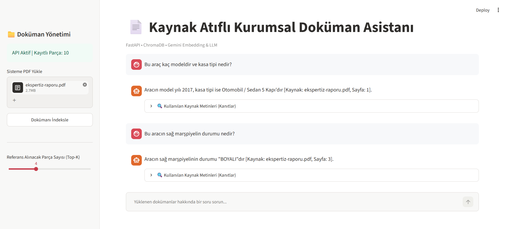

# 📄 Enterprise Citation-Based RAG Assistant


**Enterprise Citation-Based RAG Assistant** is an end-to-end Retrieval-Augmented Generation (RAG) engine built with FastAPI, ChromaDB, Google GenAI SDK, and Streamlit.

Designed for enterprise document intelligence, legal/technical auditing, and knowledge management, the system eliminates LLM hallucinations by grounding every response strictly in indexed PDF documents. By pairing semantic vector search with page-level metadata tracking and multi-model resilience, it delivers verifiable answers backed by exact document and page citations.

✅ **Architecture:** Decoupled FastAPI REST backend, persistent ChromaDB vector store, and interactive Streamlit UI  
✅ **Ideal for:** AI Engineers, Enterprise Knowledge Management, Document Auditing, and Portfolio Showcase

---

## 🧠 Overview & Methodology

The system implements a strict, verifiable three-stage RAG pipeline:

1. **📑 Page-Aware Ingestion & Chunking:** Parses uploaded PDFs via `PyPDF` and splits text using `RecursiveCharacterTextSplitter` while preserving exact source filename and page number metadata on every chunk.
2. **🔍 Semantic Vector Indexing & Retrieval:** Generates dense vector embeddings via `gemini-embedding-001` and indexes them in a persistent **ChromaDB** collection, enabling configurable Top-K similarity search with distance scoring.
3. **🛡️ Grounded Generation & Multi-Model Resilience:** Enforces low-temperature (`temperature=0.1`) context-only generation with mandatory inline citations (`[Kaynak: filename.pdf, Sayfa: X]`), backed by an automated multi-model fallback loop and async timeout handling to withstand `503 UNAVAILABLE` API spikes.

---

## ⚙️ Key Features

- **Strict Source & Page Citations:** Every generated claim is linked directly to its origin file and page number, preventing unsupported model fabrication.
- **Evidence Inspection Drawer:** Interactive UI expanders reveal the exact retrieved text chunks and cosine distance scores used to synthesize each answer.
- **Persistent Vector Storage:** Indexed embeddings are persisted locally on disk (`chroma_db/`), eliminating redundant re-indexing across server restarts.
- **Multi-Model Fallback Engine:** Automatically cycles across multiple Gemini and Gemma models with retry backoff to ensure high availability under heavy API load.
- **Dynamic Top-K Retrieval Control:** Real-time sidebar slider allowing users to tune context breadth (`Top-K`) per query.
- **Decoupled Client-Server Architecture:** Clean separation between the RESTful API layer (`app/`) and the presentation layer (`frontend/`).

---

## 🖥️ Visual Preview

### Interactive Document Q&A & Page-Level Citation Verification
*Real-time PDF ingestion, live API/index status badge, multi-page semantic retrieval, and expandable source evidence cards.*



---

## 🧰 Tech Stack

| Component | Technology | Description |
| :--- | :--- | :--- |
| **Backend API** | FastAPI / Uvicorn | High-performance async REST endpoints (`/upload`, `/ask`, `/health`) |
| **AI & Embeddings** | Google GenAI SDK | `gemini-embedding-001` embeddings & Gemini/Gemma generation models |
| **Vector Database** | ChromaDB | Persistent local vector storage and similarity search |
| **Document Processing** | LangChain & PyPDF | Page-level PDF extraction and recursive character chunking |
| **Frontend UI** | Streamlit | Interactive chat interface, file uploader, and evidence inspector |
| **Data Validation** | Pydantic | Strict request/response schema enforcement |

---

## 📁 Project Structure

```text
rag-doc-assistant/
├── app/
│   ├── api.py             # FastAPI REST endpoints & CORS/health configuration
│   └── rag_engine.py      # PDF chunking, ChromaDB persistence, retrieval & fallback LLM logic
├── frontend/
│   └── streamlit_app.py   # Interactive document upload, Top-K slider & citation chat UI
├── rag-doc.png            # Application interface screenshot
├── requirements.txt       # Python dependencies
└── .gitignore
```

---

## Get started
1. Clone the repository
   
   ```bash
   git clone [https://github.com/OmerFarukKarakoy/rag-doc-assistant.git](https://github.com/OmerFarukKarakoy/rag-doc-assistant.git)
cd rag-doc-assistant
   ```
   
2. Create a virtual environment & install dependencies

   ```bash
   python -m venv venv
.\venv\Scripts\Activate.ps1
pip install -r requirements.txt
   ```

3. Configure Environment Variables
Create a .env file in the project root and add your Google Gemini API key:

   ```bash
   GEMINI_API_KEY=your_google_gemini_api_key
   ```

4. Start the FastAPI Backend Server

   ```bash
   uvicorn app.api:app --reload
   ```

5. Launch the Streamlit Frontend (in a separate terminal)

  ```bash
   streamlit run frontend/streamlit_app.py
   ``` 

In the output, you'll find options to open the app in a


## 👨‍💻 Developer

**Ömer Faruk Karaköy**    
🌐 GitHub: [github.com/OmerFarukKarakoy](https://github.com/OmerFarukKarakoy)  
📧 Mail: omerfarukkarakoy@hotmail.com

